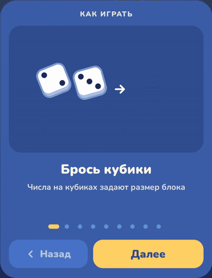
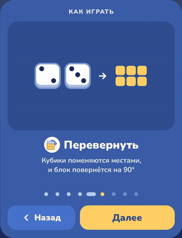
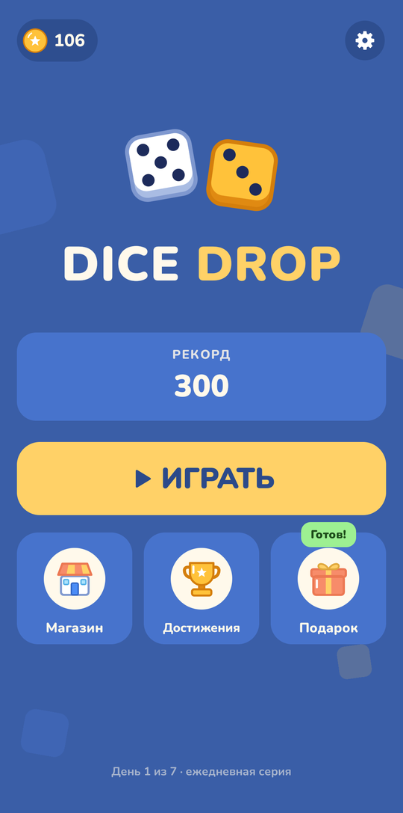
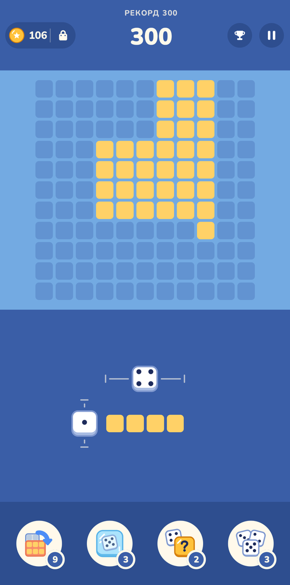
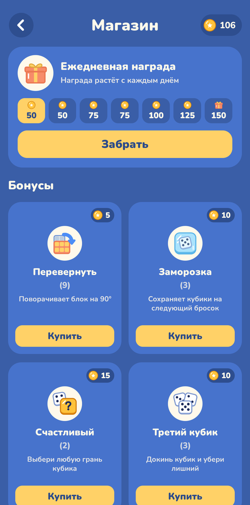
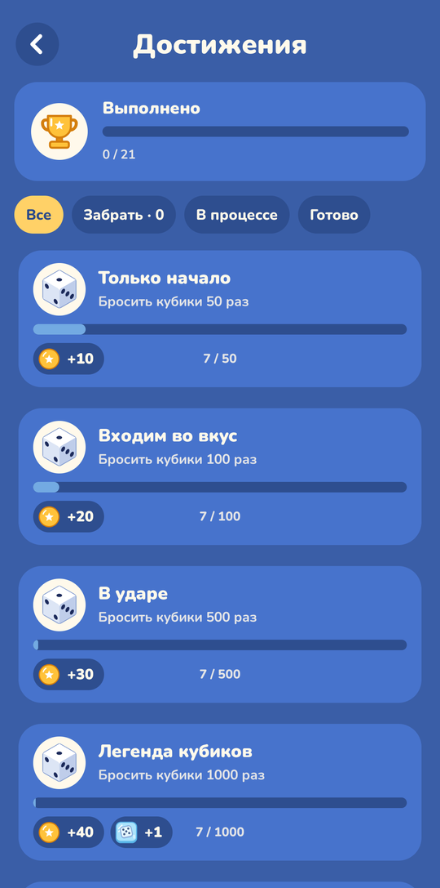

# 🎲 DiceDrop

[English](#english) | [Русский](#русский) | [Screenshots](#screenshots) | [License](#license)

  
  &nbsp;&nbsp;
  

---

## English

**DiceDrop** is a calm, cozy puzzle game where every move is decided by a roll of the dice.

Simple rules, growing tension, and one constant question: will luck be on your side this turn?

### 🧩 Gameplay

- Roll two dice — their numbers set the size of the next block: a 2 and a 3 make a 2 × 3 block
- Drag the block onto the 11 × 11 board
- Fill a whole row or column to clear it and earn points and coins
- Clear lines several moves in a row to build a combo — each next line brings more points
- The game ends when there is no room left for the block

### 🛠️ Bonuses

When luck turns against you, bonuses help you take back control:

- 🔄 **Rotate** — the dice swap places and the block turns 90°
- ❄️ **Freeze** — freezes both dice, so the next roll gives the same block
- 🎲 **Third die** — rolls one more die; remove the extra one and the block is built from the other two
- 🍀 **Lucky** — pick any face and the die that gets it

If you run out, a bonus can be bought right during the game.

### 🪙 Coins and shop

The game is meant to be relaxing, not grindy: coins come from playing, not from endless ads.

- Coins for every cleared line and a bonus for clearing the whole board
- 🎁 A daily gift that grows with your streak, with an extra bonus on day 7
- 🏅 Coins and a bonus for every new record
- 🎬 At the end of a game you can watch an ad to double the coins you earned
- 🛒 The shop sells every bonus, plus a random one for those who like to test their luck

### 🏆 Achievements

21 achievements for rolls, cleared lines, combos, scores and bonuses — each with a coin reward, some with extra bonuses.

### 📖 Tutorial

A short animated guide shows the rules and every bonus on first launch. It can be opened again any time with the **How to play** button in the pause menu or settings.

### 🎨 Look and feel

- Clean, bright visuals with smooth animations and confetti
- Sound effects, background music and vibration — each can be turned off in settings
- Russian and English

### 🛠️ Tech

Kotlin · Jetpack Compose · Decompose · MVIKotlin · Dagger · DataStore

---

## Русский

**DiceDrop** — спокойная уютная головоломка, где каждый ход решает бросок кубиков.

Простые правила, нарастающее напряжение и один вопрос: повезёт ли на этот раз?

### 🧩 Как играть

- Брось два кубика — числа на них задают размер блока: 2 и 3 дают блок 2 × 3
- Перетащи блок на поле 11 × 11
- Заполни ряд или столбец целиком — он исчезнет, а ты получишь очки и монеты
- Собирай линии несколько ходов подряд — растёт комбо, и каждая следующая линия приносит больше очков
- Игра заканчивается, когда для блока не остаётся места

### 🛠️ Бонусы

Когда удача отворачивается, бонусы помогают вернуть контроль:

- 🔄 **Перевернуть** — кубики меняются местами, и блок поворачивается на 90°
- ❄️ **Заморозка** — замораживает оба кубика, и следующий бросок даёт тот же блок
- 🎲 **Третий кубик** — докидывает ещё один кубик; убери лишний, и блок соберётся из двух других
- 🍀 **Счастливый** — выбери любую грань и кубик, который её получит

Если бонусы закончились, их можно купить прямо во время игры.

### 🪙 Монеты и магазин

Игра задумана для отдыха: монеты приходят за игру, а не за бесконечную рекламу.

- Монеты за каждую собранную линию и бонус за полностью очищенное поле
- 🎁 Ежедневный подарок, который растёт с каждым днём серии, а на 7-й день ещё и бонус
- 🏅 Монеты и бонус за каждый новый рекорд
- 🎬 В конце партии можно посмотреть рекламу и удвоить заработанные монеты
- 🛒 В магазине есть все бонусы, а для любителей рискнуть — случайный

### 🏆 Достижения

21 достижение за броски, линии, комбо, очки и бонусы — за каждое монеты, за некоторые ещё и бонусы.

### 📖 Обучение

Короткое обучение с анимациями показывает правила и все бонусы при первом запуске. Его можно открыть снова кнопкой **Как играть** в паузе или настройках.

### 🎨 Оформление

- Яркий чистый стиль, плавные анимации и конфетти
- Звуки, фоновая музыка и вибрация — каждое можно выключить в настройках
- Русский и английский языки

### 🛠️ Технологии

Kotlin · Jetpack Compose · Decompose · MVIKotlin · Dagger · DataStore

---

## Screenshots

  
  &nbsp;
  
  &nbsp;
  
  &nbsp;
  

## License

This project is licensed under the Creative Commons Attribution-NonCommercial 4.0 International License.
See the [LICENSE](LICENSE) file for details.

Commercial use is prohibited. If you are interested in commercial licensing, please contact the author.

Проект распространяется по лицензии Creative Commons Attribution-NonCommercial 4.0 International. Подробности — в файле [LICENSE](LICENSE). Коммерческое использование запрещено; по вопросам коммерческой лицензии свяжитесь с автором.
